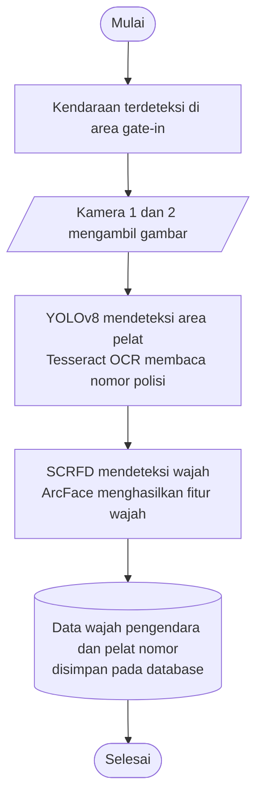
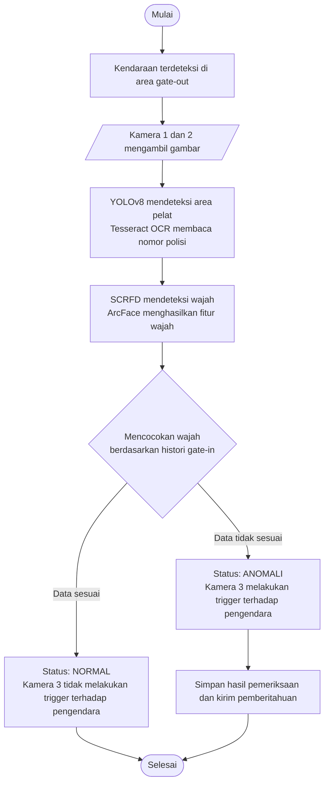
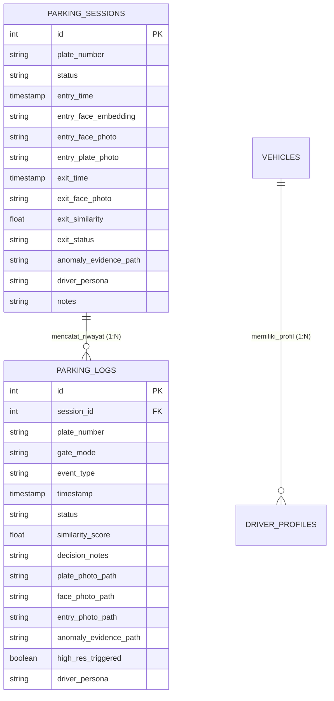

# BAB III: METODOLOGI PENELITIAN
## SISTEM KEAMANAN PARKIR MULTI-MODAL DAN DETEKSI ANOMALI PENGENDARA BERBASIS VERIFIKASI BIOMETRIK GATE-IN VS GATE-OUT DENGAN KONFIGURASI 3 KAMERA

### 3.1 Gambaran Umum & Konfigurasi 3 Kamera
Sistem yang dikembangkan bertujuan untuk mengatasi potensi tindak pencurian dan penukaran kendaraan di area parkir komersial/gedung dengan memverifikasi korelasi identitas antara kendaraan (Nomor Polisi) dan biometrik pengendara (Wajah) secara *real-time*.

Arsitektur perangkat keras mengintegrasikan **3 unit kamera** dengan fungsi terspesialisasi:
1. **Kamera 1 (Kamera Plat Nomor - ANPR View):**
   - Beroperasi secara kontinu (*live video stream*).
   - Diposisikan sejajar bumper depan kendaraan.
   - Digunakan untuk melokalisasi area pelat (YOLOv8) dan mengekstraksi karakter nomor polisi (Tesseract OCR + Otsu Binarization).
2. **Kamera 2 (Kamera Wajah Pengendara - Biometric View):**
   - Beroperasi secara kontinu (*live video stream*).
   - Diposisikan mengarah ke kokpit/jendela pengemudi.
   - Digunakan untuk mendeteksi wajah (SCRFD / YuNet) dan mengekstraksi vektor representasi biometrik 128-d (ArcFace / SFace).
3. **Kamera 3 (Kamera Standby / Hi-Res Anomaly Evidence):**
   - Beroperasi dalam mode siaga (*standby mode*).
   - Memiliki resolusi sensor lebih tinggi untuk kebutuhan forensik digital.
   - **Aturan Trigger Berdasarkan Flowchart:**
     - Jika status **NORMAL**: Kamera 3 **TIDAK** melakukan trigger terhadap pengendara.
     - Jika status **ANOMALI**: Kamera 3 **MELAKUKAN TRIGGER** otomatis memotret pengendara resolusi tinggi sebagai barang bukti digital pencurian untuk diteruskan ke pos keamanan.

---

### 3.2 Diagram Alir Sistem (*Flowchart Alur Resmi*)

Alur kerja sistem terbagi menjadi dua diagram alir:

#### A. Alur GATE-IN (Kendaraan Masuk)
1. **Mulai:** Sistem aktif memantau gerbang masuk.
2. **Kendaraan Terdeteksi di Area Gate-In:** Sensor kehadiran/loop mendeteksi mobil tiba di titik palang.
3. **Kamera 1 dan 2 Mengambil Gambar:** Kamera 1 dan Kamera 2 melakukan *simultaneous capture*.
4. **Ekstraksi Fitur:**
   - YOLOv8 mendeteksi area pelat $\rightarrow$ Tesseract OCR membaca nomor polisi.
   - SCRFD mendeteksi wajah $\rightarrow$ ArcFace menghasilkan fitur vektor biometrik ($d = 128$).
5. **Penyimpanan Database:** Data wajah pengendara dan pelat nomor disimpan pada tabel sesi aktif database (`status = IN_PARKING`).
6. **Selesai:** Palang masuk terbuka otomatis.

---

#### B. Alur GATE-OUT (Kendaraan Keluar)
1. **Mulai:** Kendaraan tiba di pos gerbang keluar.
2. **Kendaraan Terdeteksi di Area Gate-Out:** Sensor mendeteksi kendaraan.
3. **Kamera 1 dan 2 Mengambil Gambar:** Kamera 1 (Plat) dan Kamera 2 (Wajah) mengambil gambar kembali.
4. **Ekstraksi Fitur:**
   - YOLOv8 mendeteksi pelat $\rightarrow$ Tesseract OCR membaca nomor polisi.
   - SCRFD mendeteksi wajah $\rightarrow$ ArcFace menghasilkan fitur vektor biometrik saat keluar.
5. **Mencocokkan Wajah Berdasarkan Histori Gate-In:**
   - Sistem mencari data tiket masuk di database berdasarkan nomor plat.
   - Menghitung Cosine Similarity antara wajah keluar dan wajah masuk:
     $$\text{Cosine Similarity} = \frac{\mathbf{u} \cdot \mathbf{v}}{\|\mathbf{u}\| \|\mathbf{v}\|}$$
6. **Percabangan Keputusan:**
   - **Jika Data Sesuai ($\text{Similarity} \ge \tau$):**
     - Status: **NORMAL**.
     - **Kamera 3 tidak melakukan trigger terhadap pengendara.**
     - Palang gerbang keluar dibuka otomatis.
     - Selesai.
   - **Jika Data Tidak Sesuai ($\text{Similarity} < \tau$):**
     - Status: **ANOMALI**.
     - **Kamera 3 melakukan trigger terhadap pengendara** (mengambil foto bukti resolusi tinggi).
     - Simpan hasil pemeriksaan dan kirim pemberitahuan alarm ke pos keamanan.
     - Selesai.

---

### 3.3 Parameter dan Ambang Batas Pengujian
* **Ambang Batas Kemiripan Simulasi ($\tau_{\text{sim}}$):** `0.65` ($65\%$).
* **Ambang Batas Kemiripan Kamera Live SFace ($\tau_{\text{real}}$):** `0.45` ($45\%$).
* **Dimensi Embedding Wajah:** $1 \times 128$ float32.
* **Resolusi Kamera 1 (Plat):** 1280x720 / 640x480 ANPR.
* **Resolusi Kamera 2 (Wajah):** 1280x720 / 640x480 Biometrik.
* **Resolusi Kamera 3 (Forensik):** Sensor Resolusi Penuh (*Full Native Resolution Snapshot*).

---

### 3.4 Matriks Evaluasi Ilmiah
1. **Akurasi, Presisi, Recall, dan F1-Score** pada 100 sampel pengujian sesi (50 pengemudi sah vs 50 orang asing/curanmor).
2. **False Acceptance Rate (FAR):** Probabilitas pencuri salah lolos sebagai pemilik sah (target: $0.0\%$).
3. **False Rejection Rate (FRR):** Probabilitas pemilik sah salah ditahan (target: $0.0\%$).
4. **Akurasi Trigger Kamera 3:** Tingkat keberhasilan pemicuan Kamera 3 pada kondisi anomali ($100\%$).

---

### 3.5 Perancangan Basis Data (Entity Relationship Diagram / ERD)
Struktur basis data dirancang untuk mendukung pencatatan status sesi verifikasi masuk (*Gate-In*) dan keluar (*Gate-Out*) serta pencatatan audit log transaksi secara terpisah.

*Dokumentasi spesifikasi lengkap kamus data dan struktur tabel dapat dilihat pada berkas [docs/ERD_DATABASE.md](ERD_DATABASE.md).*
