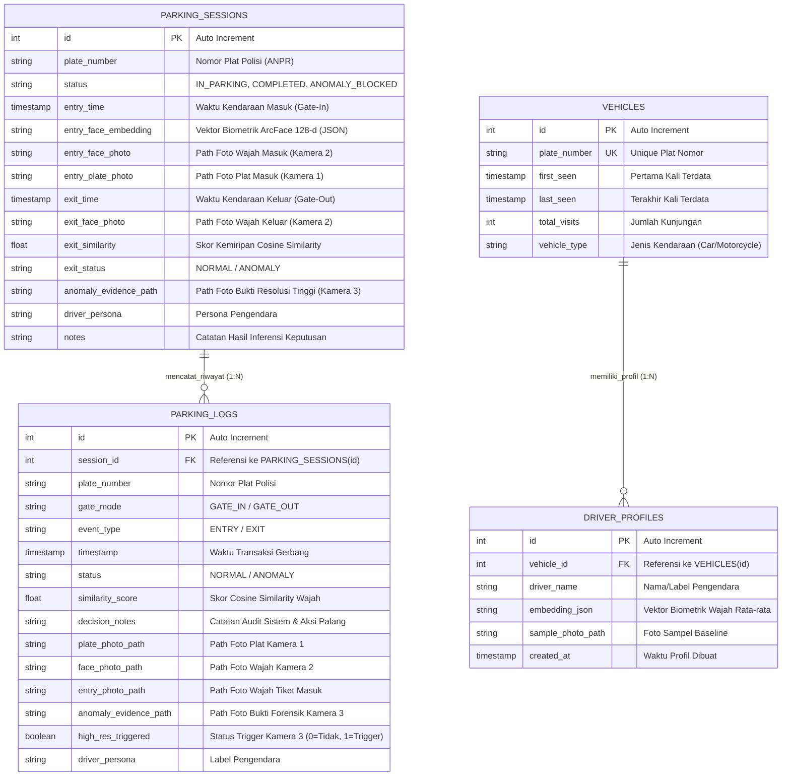

# Entity Relationship Diagram (ERD) & Desain Basis Data
## Sistem Deteksi Anomali Parkir Berbasis Verifikasi Biometrik Multi-Kamera

Dokumen ini berisi spesifikasi arsitektur basis data, diagram relasi entitas (*Entity Relationship Diagram* / ERD), dan kamus data (*data dictionary*) yang diimplementasikan pada sistem menggunakan engine SQLite 3 / Relasional RDBMS.

---

### 1. Diagram Relasi Entitas (ERD - Mermaid)

---

### 2. Kamus Data (Data Dictionary)

#### A. Tabel `parking_sessions` (Entitas Utama Sesi Verifikasi Gerbang)
Tabel ini merekam siklus hidup keberadaan kendaraan sejak masuk pintu gerbang (*Gate-In*) hingga keluar (*Gate-Out*).

| Nama Kolom | Tipe Data | Constraint | Deskripsi |
| :--- | :--- | :--- | :--- |
| `id` | INTEGER | PRIMARY KEY, AUTOINCREMENT | Identifier unik sesi parkir. |
| `plate_number` | TEXT | NOT NULL | Nomor polisi kendaraan hasil OCR Tesseract / YOLOv8. |
| `status` | TEXT | NOT NULL | Status sesi: `'IN_PARKING'` (sedang parkir), `'COMPLETED'` (selesai normal), `'ANOMALY_BLOCKED'` (tertahan anomali). |
| `entry_time` | TIMESTAMP | NOT NULL | Waktu kendaraan melintasi gerbang masuk (*Gate-In*). |
| `entry_face_embedding` | TEXT | NOT NULL | Vektor fitur wajah berdimensi 128 (*embedding vector*) dalam format JSON array float. |
| `entry_face_photo` | TEXT | NULLABLE | URL/path file foto wajah pengendara saat masuk (Kamera 2). |
| `entry_plate_photo` | TEXT | NULLABLE | URL/path file foto plat nomor saat masuk (Kamera 1). |
| `exit_time` | TIMESTAMP | NULLABLE | Waktu kendaraan tiba di gerbang keluar (*Gate-Out*). |
| `exit_face_photo` | TEXT | NULLABLE | URL/path file foto wajah pengendara saat keluar (Kamera 2). |
| `exit_similarity` | REAL | NULLABLE | Skor kecocokan biometrik antara wajah masuk vs wajah keluar (0.00 – 1.00). |
| `exit_status` | TEXT | NULLABLE | Keputusan verifikasi keluar: `'NORMAL'` atau `'ANOMALY'`. |
| `anomaly_evidence_path` | TEXT | NULLABLE | URL/path foto bukti resolusi tinggi dari Kamera 3 jika status `'ANOMALY'`. |
| `driver_persona` | TEXT | NULLABLE | Keterangan persona pengendara (Pengemudi Sah / Orang Lain). |
| `notes` | TEXT | NULLABLE | Rincian catatan log keputusan sistem dan status pembukaan palang. |

---

#### B. Tabel `parking_logs` (Entitas Audit Log Riwayat Transaksi)
Tabel ini mencatat seluruh rangkaian riwayat transaksi gerbang secara kronologis (*immutable audit trail*) untuk keperluan rekapitulasi data, bukti forensik sidang, dan transparansi sistem keamanan.

| Nama Kolom | Tipe Data | Constraint | Deskripsi |
| :--- | :--- | :--- | :--- |
| `id` | INTEGER | PRIMARY KEY, AUTOINCREMENT | Identifier unik log transaksi. |
| `session_id` | INTEGER | FOREIGN KEY, NULLABLE | Relasi ke `parking_sessions.id`. |
| `plate_number` | TEXT | NOT NULL | Nomor polisi kendaraan yang melintas. |
| `gate_mode` | TEXT | NOT NULL | Mode gerbang operasional: `'GATE_IN'` atau `'GATE_OUT'`. |
| `event_type` | TEXT | NOT NULL | Tipe aksi gerbang: `'ENTRY'` atau `'EXIT'`. |
| `timestamp` | TIMESTAMP | NOT NULL | Waktu presisi saat transaksi diproses oleh sistem. |
| `status` | TEXT | NOT NULL | Hasil evaluasi: `'NORMAL'` atau `'ANOMALY'`. |
| `similarity_score` | REAL | NULLABLE | Nilai Cosine Similarity biometrik wajah. |
| `decision_notes` | TEXT | NULLABLE | Narasi audit keputusan verifikasi & aksi palang pintu. |
| `plate_photo_path` | TEXT | NULLABLE | Arsip foto Kamera 1 (Plat ANPR). |
| `face_photo_path` | TEXT | NULLABLE | Arsip foto Kamera 2 (Wajah Pengendara). |
| `entry_photo_path` | TEXT | NULLABLE | Arsip foto pembanding saat gerbang masuk. |
| `anomaly_evidence_path` | TEXT | NULLABLE | Arsip foto bukti forensik Kamera 3. |
| `high_res_triggered` | BOOLEAN | DEFAULT 0 | Status pemicu Kamera 3: `0` (Standby / Tidak Trigger), `1` (Trigger Anomali). |
| `driver_persona` | TEXT | NULLABLE | Persona pengendara saat kejadian. |

---

#### C. Tabel Kompatibilitas `vehicles` & `driver_profiles`
Disediakan untuk mendukung skenario profil kendaraan berkala (*multi-visit baseline*) jika diperlukan penelitian lanjutan:
* **`vehicles`**: Menyimpan rekam jejak plat nomor kendaraan, total frekuensi kunjungan (`total_visits`), serta timestamp pertama & terakhir berkunjung.
* **`driver_profiles`**: Menyimpan representasi centroid embedding biometrik pengemudi terdaftar untuk kendaraan bersangkutan (`1:N` relasi dengan `vehicles`).

---

### 3. Kardinalitas dan Relasi Antar Tabel
1. **`parking_sessions` ke `parking_logs` (`1 : N`)**:
   - Satu sesi parkir kendaraan (`parking_sessions`) memiliki relasi *one-to-many* ke riwayat log (`parking_logs`). 
   - Minimal terdapat 1 log saat kendaraan masuk (*Gate-In*), dan bertambah 1 log saat kendaraan mencoba keluar (*Gate-Out*).
   - Pada model relasional, `parking_logs.session_id` merujuk (*Foreign Key*) ke `parking_sessions.id` dengan aturan `ON DELETE SET NULL`.
2. **`vehicles` ke `driver_profiles` (`1 : N`)**:
   - Satu kendaraan dapat memiliki satu atau lebih profil biometrik pengemudi sah yang terasosiasi (`vehicles.id` merujuk ke `driver_profiles.vehicle_id` dengan aturan `ON DELETE CASCADE`).

---

### 4. Letak File Database Fisik di Sistem
* **Engine Basis Data:** SQLite 3 (Standar file tunggal ringan tanpa perlu instalasi server terpisah).
* **Lokasi File Database:** `backend/storage/parking.db`
* **File Inisialisasi Skema:** `backend/app/database.py` (Fungsi `init_db()`)
